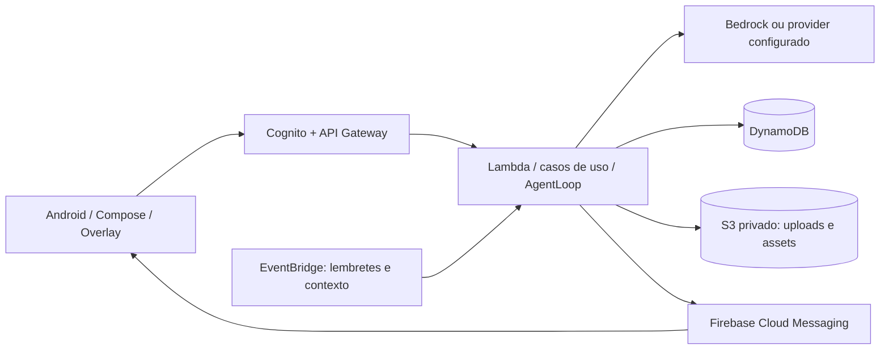

# RIN — componentes técnicos públicos

Implementação de referência de uma assistente Android com backend serverless. Esta edição publica código, contratos, testes e infraestrutura. A instalação pessoal, dados de usuários, configurações operacionais, imagens e demais assets permanecem privados.

O fluxo principal usa **Android → API Gateway → Lambda → Amazon Bedrock**. Não há servidor MCP neste projeto. O backend também contém adapters opcionais para outros providers, selecionados por configuração.



| Diretório | Conteúdo público |
| --- | --- |
| `backend/src` | Domínio, casos de uso, agente, tools, adapters e bootstrap |
| `backend/tests` | Testes com dados sintéticos |
| `backend/infra/terraform` | Recursos AWS parametrizados, sem state ou credenciais |
| `backend/seed` | Exemplos sintéticos, sem perfil ou relacionamento pessoal |
| `android` | Aplicativo Kotlin, Compose, overlay, autenticação e notificações |
| `scripts` | Verificação de publicação e proteção contra inclusão de dados privados |

## Executar as verificações

Requisitos: Node.js 22 ou superior, JDK 17, Gradle 9.7.1 e Android SDK 37. As versões do projeto estão fixadas nos arquivos de build e lockfiles.

```sh
npm run test:publication
npm run check:publication
cd backend
npm ci
npm test
npm run typecheck
npm run lint
npm run build
```

Para Android, configure `ANDROID_HOME` e execute com Gradle instalado:

```sh
cd android
gradle --no-configuration-cache testDebugUnitTest assembleDebug lintDebug
```

O JAR do wrapper não é distribuído: este repositório contém apenas texto. Use Gradle 9.7.1 instalado, ou gere o wrapper localmente com `gradle wrapper`; o JAR continuará ignorado.

O build cria figuras geométricas neutras em `app/build/generated/publicResources`. Não lê, baixa ou copia os assets privados da RIN. Sem configuração Firebase, o plugin Google Services fica desativado e notificações remotas exigem configuração própria. Autenticação e APIs dependem de um ambiente próprio configurado nas variáveis `RIN_AGENT_BASE_URL`, `RIN_COGNITO_CLIENT_ID`, `RIN_COGNITO_USER_POOL_ID` e `RIN_COGNITO_REGION`.

Leia [arquitetura](docs/ARCHITECTURE.md), [configuração](docs/DEVELOPMENT.md) e [política de publicação](docs/PUBLICATION.md). Este repositório é uma amostra técnica, sem CI ou deploy automático. As verificações podem ser executadas localmente.

Publicar o código não concede direitos sobre personagens ou assets privados. Nenhuma licença de reutilização é concedida por este README; a escolha de licença é independente desta separação técnica.
