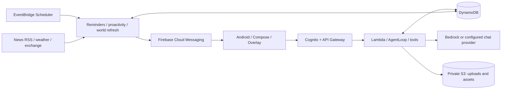
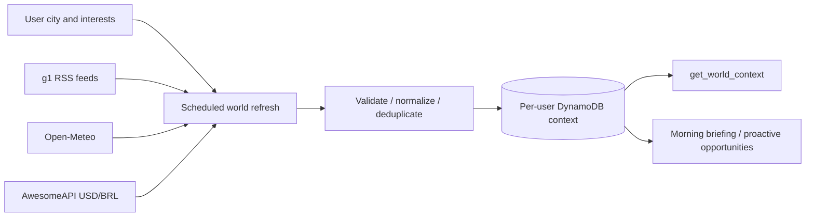

# RIN — a contextual Android assistant

RIN combines an Android character overlay with a serverless agent that remembers conversational context, manages everyday tasks and reminders, and responds with a configurable personality. Her delivery can reflect a persisted mood, relationship state, local weather and time of day. Scheduled background jobs collect news and prepare proactive messages, including a morning briefing.

This repository contains the public technical implementation: Android and backend code, contracts, tests, synthetic seeds and Terraform. Running a connected installation requires your own infrastructure and configuration. Personal profiles, operational settings, credentials, character images and other private assets are not included.

## Contents

- [Capabilities](#capabilities)
- [Architecture and request flow](#architecture-and-request-flow)
- [Personality, mood and social style](#personality-mood-and-social-style)
- [News, weather and world context](#news-weather-and-world-context)
- [Memory and conversation continuity](#memory-and-conversation-continuity)
- [Reminders and proactive messages](#reminders-and-proactive-messages)
- [Configuration and setup](#configuration-and-setup)
- [Development checks](#development-checks)
- [Repository map and current boundaries](#repository-map-and-current-boundaries)

## Capabilities

| Area | Implemented behavior |
| --- | --- |
| Android companion | Native Kotlin/Compose screens, draggable character overlay, message bubbles, visual states and local device actions such as focus sessions and alarms. |
| Conversation | Model-backed replies with user context, recent exchanges, assistant-specific behavior and scoped tools. The assistant catalog supports RIN and YUI identities. |
| Personality | Configurable personality definitions, mood and intimacy scores, social delivery controls and asynchronous behavior feedback. |
| Everyday organization | Tasks, reminders, shopping lists and completion tracking persisted in DynamoDB. |
| World context | Scheduled collection of interest-based news headlines, local weather and USD/BRL quotes; cached facts available to chat and briefings. |
| Proactivity | Scheduled reminder delivery, opportunity-based messages and a morning briefing, subject to delivery gates and user settings. |
| Finance | Personal records, budgets, bills, debts, planning, purchase assessment and statement-import infrastructure. No payment execution or investment trading. |
| Support | A dedicated conversational skill with restricted context and tools, plus consent-based follow-ups. |
| Appearance | Asset catalogs and selection based on context, mood, occasion and manual preferences. Public Android builds use generated geometric placeholders. |

The built-in [skill catalog](backend/src/application/skills/catalog.ts) separates conversation, finance, support and user-initiated flirting. Each skill declares its tools, context needs and proactive capabilities; availability also depends on assistant/user enablement. Flirting is disabled by default in the catalog and cannot propose proactive messages.

## Architecture and request flow

The main connected flow is **Android → API Gateway → Lambda → configured model provider**. AWS deployments can use Amazon Bedrock directly. There is no MCP server between the app and the model.



1. Authentication resolves an internal user identity. The request selects an assistant and conversation.
2. `AgentContextBuilder` loads persona, profile, relationship, memories, pending items and fresh world context through repositories.
3. Behavior and time/weather overlays determine the current delivery style. Skill selection limits the relevant context and available tools.
4. `SystemPromptRenderer` prepares the prompt; `AgentLoop` coordinates model calls and validated tool execution.
5. The response supplies text, an avatar state, priority and any supported client actions. Recent conversation turns are persisted; eligible social interactions can be evaluated asynchronously.

The backend follows `entrypoints/adapters → application → domain`, with manual dependency wiring. DynamoDB is the runtime source of truth. Markdown in `backend/seed/` supplies bootstrap defaults; handlers do not reload those files on every request. Editing a seed does not change an existing user's stored configuration.

See [architecture](docs/ARCHITECTURE.md), [context assembly](backend/src/application/agent/context-builder.ts) and the [agent loop](backend/src/application/agent/loop.ts).

## Personality, mood and social style

RIN's behavior has several independent layers. In particular, **mood** describes her current disposition, while **humor** in `socialConfig.humorLevel` controls how much joking is welcome.

| Layer | Configuration | Meaning |
| --- | --- | --- |
| Identity and persona | Assistant definition, persona and relationship records | Who is speaking, core guidance and known user context. |
| Personality | `personalityId` → an enabled `PersonalityDefinition` | The selected voice, expressed through named traits and prompt guidance. |
| Mood | `moodScore`, number from **0–10** | Current disposition: low/grumpy at ≤3, happy at ≥7, neutral between those thresholds. Default base score: **5**. |
| Relationship | `intimacyScore`, number from **0–10** | Simulated familiarity/relationship progression. Default: **3**. Absence does not reduce intimacy. |
| Social delivery | `socialConfig`, integer controls from **0–100** | Familiarity, profanity, jokes, sarcasm, dark humor and teasing. Applies to **RIN**. |
| Contextual delivery | Weather, headlines, local time and live-state metrics | Temporary adjustments to energy, patience, irritability, curiosity and avatar tone. |

Behavior is stored per **user and assistant**. Personality definitions are separate, versioned records with an ID, name, enabled flag, traits from `0` to `1`, and a list of guidance strings. RIN falls back to the `tsundere` personality ID when no selection/default is present; that definition must still exist and be enabled in the database.

The diagnostic command lists `tsundere`, `deredere`, `dandere`, `kuudere` and `yandere` as initial options. These are identifiers for configured profiles, not hard-coded personality implementations. The public seed does not provision this personality catalog: operators must supply their own definitions. See the [behavior schemas](backend/src/domain/model/assistant-behavior.ts) and [repositories](backend/src/adapters/outbound/dynamodb/assistant-behavior-repository.ts).

### Social controls

| Field | Required | Effect |
| --- | --- | --- |
| `familiarity` | Yes | Informality and familiar conversational address; does not create shared memories or change intimacy. |
| `profanityLevel` | Yes | Permission/intensity for context-appropriate swearing. `0` disables it. |
| `humorLevel` | Yes | General intensity of jokes and comic observations. `0` requests straightforward replies. |
| `sarcasmLevel` | No | Sarcasm and irony; inherits `humorLevel` when omitted. |
| `darkHumorLevel` | No | Contextual dark or morbid humor; inherits `humorLevel` when omitted. |
| `teasingLevel` | No | Playful teasing and reciprocal banter; inherits `humorLevel` when omitted. |

Example **behavior configuration fragment**, with informal delivery, moderate joking and no profanity or dark humor:

```json
{
  "socialConfig": {
    "familiarity": 70,
    "profanityLevel": 0,
    "humorLevel": 50,
    "sarcasmLevel": 30,
    "darkHumorLevel": 0,
    "teasingLevel": 40
  }
}
```

These values are intensity ceilings, not probabilities or quotas. Setting `100` does not require a joke in every reply and does not increase mood or intimacy. Omitting `socialConfig` preserves the existing personality delivery. Explicit social controls override conflicting legacy delivery guidance while preserving the rest of the selected personality.

Serious distress and support requests take priority over teasing and sarcasm. Scores never restrict access to ordinary help. User-initiated reciprocal flirting additionally requires the enabled skill, intimacy of at least `8`, mood of at least `7` and a receptive disposition; social levels do not bypass those checks. RIN does not initiate flirting in briefings or proactive messages.

**Applying these settings:** the JSON above is a schema example, not an HTTP request or an automatically loaded file. This public edition does not include an administrative CLI or settings endpoint for `socialConfig`. An administrative integration should validate with `socialConfigSchema`, load the current state with `DynamoDbAssistantBehaviorRepository.get`, preserve unrelated fields, and call `save` with the previous version, the next version and an `admin` audit entry. The repository commits state and audit together and rejects concurrent conflicting writes. Create missing personality definitions through `DynamoDbPersonalityRepository.insertMissing` before selecting them.

### Mood evolution and contextual effects

Eligible completed conversations can produce a `friendly`, `offensive` or `neutral` assessment. The model classifies the exchange; deterministic backend rules decide whether and how scores change. With behavior feedback enabled, RIN's current policy is:

| Accepted signal | Mood change | Intimacy change | Daily limits |
| --- | --- | --- | --- |
| Friendly exchange, confidence ≥0.75 | +0.2 | +0.1 | +2 mood / +0.5 intimacy |
| Direct hostility, confidence ≥0.90 | −0.5 | −0.2 | −3 mood / −1 intimacy |
| Neutral, protected or insufficient-confidence event | No change | No change | — |

Scores stay within `0–10`. Duplicate, expired and out-of-order events are guarded against; older events cannot undo a manual override. Protection rules exclude operational requests, criticism, boundaries, quoted text and distress from social penalties. The implementation retains Portuguese-specific detection patterns, so these rules are not a claim of complete multilingual coverage.

Between interactions, the derived mood moves toward `5` by `0.1` per elapsed whole hour. This read-time recovery does not reduce intimacy. The `evolutionEnabled` flag controls interaction-based updates; it does not disable the independent time-based mood calculation.

Rain and current heat above 30°C can affect delivery metrics; available headlines can increase curiosity. Between **22:00 and 06:00** in the effective user time zone, a sleepy overlay reduces energy and sociability. These overlays do not overwrite the persisted base mood or switch the selected personality. They can influence wording and avatar selection without changing facts.

Implementation: [evolution policy](backend/src/domain/model/behavior-evolution.ts), [interaction processor](backend/src/application/behavior/process-interaction.ts), [social style](backend/src/application/behavior/social-style.ts), [night/mood delivery](backend/src/application/agent/rin-mood.ts).

### Inspecting and overriding behavior

Users can ask `What is your mood?`, `What is our intimacy?` or `What is your personality?`. Read tools report stored/derived values rather than inventing scores.

Manual diagnostic changes require `diagnosticsEnabled: true` on that user's assistant behavior, which defaults to **false**. Send one complete command per message:

```text
hypnosis: mood 7
hypnosis: intimacy 4
hypnosis: personality deredere
```

Portuguese forms such as `hipnose: humor 7` are also supported. Only direct user messages are parsed; quoted commands, news content and tool output are not an administration channel. Changes validate the requested values, require an enabled personality when applicable, and use version checks and an audit record. These commands do not configure social levels. See [diagnostic commands](backend/src/application/behavior/hipnose.ts).

## News, weather and world context

World context is a **scheduled ingestion pipeline**. Chat reads previously collected observations from DynamoDB; asking for today's news does not trigger a live web search.



### Preferences and sources

`get_world_preferences` reads settings; `set_world_preferences` updates them on an explicit user request. The first configuration requires a city. Omitted fields retain previous values. For example, a request to enable technology news and dollar quotes for São Paulo can use these tool arguments:

```json
{
  "enabled": true,
  "morningBriefingEnabled": true,
  "city": "São Paulo",
  "region": "São Paulo",
  "interests": ["tecnologia", "dolar"]
}
```

The initial settings default collection and morning briefings to enabled, with no news/exchange interests unless supplied. Weather is collected for the configured location whenever world collection is enabled. The current geocoder accepts Brazilian cities in the **America/Sao_Paulo** time zone.

| Data | Source configured in the adapter | Selection |
| --- | --- | --- |
| Politics headlines | g1 politics RSS | `politica` |
| Economy headlines | g1 economy RSS | `economia` |
| Technology headlines | g1 technology RSS | `tecnologia` |
| USD/BRL bid, ask and change | AwesomeAPI | `dolar` |
| Current weather and daily forecast | Open-Meteo | Configured city coordinates |

The Portuguese topic identifiers are stable API values, even when the conversation is in English. Endpoints are fixed in [PublicWorldSources](backend/src/adapters/outbound/world/public-sources.ts); preferences do not accept arbitrary feed URLs. Adding a source or topic requires an adapter/schema change.

### Collection, freshness and use

- **Schedule:** the supplied Terraform schedules refresh at **07:00 and 12:00**, and the morning briefing at **08:00**, in `var.timezone` (default `America/Sao_Paulo`). These are deployment schedules, not configurable per-user cron expressions.
- **News ingestion:** validate RSS, accept HTTPS g1 article URLs, remove URL query/fragment noise, strip markup, and retain up to **5 items per category / 15 total**. Headlines are limited to 220 characters; summaries use the feed subtitle, up to 320 characters. Full articles are not fetched.
- **Freshness:** news must be no more than 36 hours old. Cache validity is at most 8 hours, capped by source age. Weather observations older than 2 hours are rejected during collection; exchange observations may be up to 4 days old and must be described as the latest available quote. Records retain source URLs plus observation, fetch and expiration timestamps.
- **Partial failures:** a failed source can fall back to still-valid cached data from compatible settings. Expired observations are filtered out. Changes to preferences invalidate the old context until a compatible refresh, and settings are checked again before persisting a collection.
- **Chat reads:** `get_world_context` accepts `geral`, `politica`, `economia`, `tecnologia`, `dolar` or `clima`, with a limit from 1 to 5 (default 3). It reports `liveSearchPerformed: false` and an explicit availability status.
- **Briefings:** the morning message uses fresh facts, names the news source, distinguishes publication time from collection time, and avoids presenting forecasts as current conditions. Mention flags survive compatible refreshes to reduce repeated proactive headlines; explicit news requests can still return an already-mentioned item.

Setting `morningBriefingEnabled: false` stops that briefing while retaining collection. Setting `enabled: false` disables world collection and hides world facts from chat. Source text is untrusted context, never an instruction to execute tools or change behavior.

See [preferences](backend/src/application/world/settings.ts), [refresh](backend/src/application/world/refresh.ts), [cached reads](backend/src/application/world/read-context.ts) and [world schedules](backend/infra/terraform/environments/dev/world.tf).

## Memory and conversation continuity

DynamoDB holds user profiles, relationship context, routines, people, working memory, long-term memory, tasks, reminders and world snapshots. These are distinct records with different purposes; a friendly writing style does not imply knowledge of a user's life.

Working memory retains the **last four exchanges**, with up to **4,000 characters per side** and a **24-hour TTL** refreshed on update. Exact recent turns are stored without waiting for a second model call to summarize them. Older summaries remain readable. When the client omits a conversation ID, the backend can maintain continuity by user, assistant and device; an explicit ID selects a separate conversation.

Skill-specific context policies reduce what finance, support and flirt conversations receive. New authenticated profiles start without a fabricated shared history. See [working memory](backend/src/application/use-cases/working-memory.ts) and [skill context policy](backend/src/application/skills/context-policy.ts).

## Reminders and proactive messages

Reminder ticks handle scheduled/upcoming items, overdue follow-ups and slots for unscheduled reminders. Proactive ticks evaluate opportunities from context and user preferences, while the morning briefing has its own scheduled entry point. Delivery uses registered, enabled devices and FCM.

Default proactive gates in the backend are a **180-minute minimum cooldown**, **3 messages per day**, and quiet hours from **23:30 to 08:00**. A base chance of `0.1` participates in ordinary proactive selection; user initiative settings can override defaults. The morning briefing also checks delivery gates, requires fresh world data, and uses a daily claim to avoid duplicate attempts. An enabled schedule alone does not guarantee a push.

These proactive limits are separate from reminder settings such as overdue notification intervals. Android overlay pushes use FCM data messages; Firebase credentials, device registration and platform permissions must be configured for delivery.

## Configuration and setup

There are three configuration surfaces:

| Surface | Examples | How changes take effect |
| --- | --- | --- |
| Backend environment and Terraform | Providers, table/bucket names, secrets, schedules, delivery limits | Supply variables to the process or deploy updated infrastructure/Lambda settings. |
| Runtime records in DynamoDB | Personality definitions, per-user mood/social settings, world preferences, memories | Update through the relevant repository/use case; seed files are not a live configuration store. |
| Android build and device settings | API URL, Cognito identifiers, Firebase configuration, overlay permission | Rebuild for build-time values; grant device permissions and register the device. |

### Backend and models

Start with [backend/.env.example](backend/.env.example). It is a reference file and is **not loaded automatically**. `loadConfig` reads process environment variables.

| Variable | Purpose |
| --- | --- |
| `APP_ENV`, `AWS_REGION`, `TABLE_NAME`, `TIMEZONE` | Runtime environment, AWS region, DynamoDB table and default time zone. |
| `MODEL_PROVIDER` | Background/default model path: `static` or `bedrock`. |
| `BEDROCK_MODEL_ID` | Model used by the default Bedrock path. |
| `AGENT_MODEL_PROVIDER` | Optional interactive-agent override: `static`, `bedrock`, `bedrock-openai` or `openai`. |
| `AGENT_BEDROCK_MODEL_ID` | Optional interactive model for the Bedrock adapter. |
| `BEDROCK_OPENAI_MODEL_ID` | Model/profile for the Bedrock Responses adapter using AWS authentication. |
| `OPENAI_MODEL_ID`, `OPENAI_SECRET_ARN` | Direct OpenAI model and Secrets Manager credential reference; `OPENAI_API_KEY` is also accepted for local configuration. |
| `FIREBASE_SECRET_ARN` | Firebase service-account secret for server-side push delivery. |
| `BEHAVIOR_FEEDBACK_ENABLED`, `BEHAVIOR_FEEDBACK_FUNCTION_ARN` | Asynchronous interaction assessment. Terraform enables it when `enable_behavior_evolution` is true and the background provider is Bedrock. |
| `WORLD_REFRESH_ENABLED`, `PROACTIVE_TICK_ENABLED`, `REMINDER_TICK_ENABLED` | Runtime switches for scheduled workers; EventBridge schedules also need to be enabled. |

Changing the model provider does not change the personality or social settings in DynamoDB. The `static` provider avoids model calls but does not replace persistence: handlers using DynamoDB still need a configured table or mocked repositories. Provider model IDs require access and matching IAM permissions in your own deployment.

For an installation, configure AWS credentials outside Git, review the [Terraform example](backend/infra/terraform/environments/dev/terraform.tfvars.example), build the backend bundles and follow [development setup](docs/DEVELOPMENT.md). Store service credentials in Secrets Manager and supply your own ARNs.

`npm run seed:dev` runs a development-only bootstrap using `INTERNAL_USER_ID`; it defaults to `insert-missing` and preserves existing records. Provision the assistant/personality catalog and relevant user settings as well: the synthetic seed is not a complete operational installation. The explicit `--overwrite` option replaces seeded records and should be reserved for a deliberate reset.

### Android

Configure `RIN_AGENT_BASE_URL` (base URL without `/agent/message`), `RIN_DEVICE_ID`, `RIN_COGNITO_CLIENT_ID`, `RIN_COGNITO_USER_POOL_ID` and `RIN_COGNITO_REGION` in the build environment. Rebuild after changing them.

Provide your own `android/app/google-services.json` for Firebase. Without that file the Google Services plugin is disabled. Grant overlay permission on the device and configure authentication/API access for a connected experience.

The build creates neutral geometric placeholders in `app/build/generated/publicResources`. It does not read, download or copy private RIN assets. Real character images require your own asset storage/catalog and rights to the artwork.

## Development checks

Requirements: **Node.js 22+**, **JDK 17**, **Gradle 9.7.1** and **Android SDK 37**. Project versions are pinned in build files and lockfiles.

From the repository root:

```sh
npm run test:publication
npm run check:publication
cd backend
npm ci
npm test
npm run typecheck
npm run lint
npm run build
```

Backend tests use synthetic data and mocks without requiring live AWS or Firebase services. For Android, set `ANDROID_HOME` and run from the repository root with an installed Gradle distribution:

```sh
cd android
gradle --no-configuration-cache testDebugUnitTest assembleDebug lintDebug
```

The wrapper JAR is not distributed: this repository contains text only. Use an installed Gradle 9.7.1 distribution or generate the wrapper locally with `gradle wrapper`; the JAR remains ignored.

Terraform validation commands and environment setup are in [DEVELOPMENT.md](docs/DEVELOPMENT.md). Infrastructure deployment creates resources in your own AWS account. This repository has no CI or automatic deployment; checks are run locally.

## Repository map and current boundaries

| Directory | Contents |
| --- | --- |
| `backend/src/domain` | Behavior, identities, finance, world models and validation rules. |
| `backend/src/application` | Agent orchestration, skills, tools, use cases, behavior and world-context logic. |
| `backend/src/adapters` | HTTP/Lambda integrations, DynamoDB, model providers, public sources and other external services. |
| `backend/src/bootstrap` | Configuration, dependency wiring, seed command and worker entry points. |
| `backend/tests` | Unit and integration-style tests with synthetic data. |
| `backend/infra/terraform` | Parameterized AWS resources without state or credentials. |
| `backend/seed` | Synthetic bootstrap examples without personal profiles or relationships. |
| `android` | Kotlin app, Compose UI, overlay, local actions, authentication and notifications. |
| `scripts` | Publication checks and protection against including private data. |
| `docs` | [Architecture](docs/ARCHITECTURE.md), [development setup](docs/DEVELOPMENT.md) and [publication policy](docs/PUBLICATION.md). |

This is a technical reference implementation with deployment-dependent features. It does not ship a ready-to-use backend, operational personality catalog, arbitrary web-search tool or complete administration UI. News ingestion currently targets the fixed Brazilian sources and location/time-zone constraints described above.

Tools carry schemas and risk metadata, but the current [ConfirmationPolicy](backend/src/application/agent/confirmation.ts) returns `false`: backend tool selection does **not** guarantee a separate confirmation prompt before a write. Skill/tool restrictions, ownership checks and validation remain distinct controls; deployments that require write approvals must implement that policy.

Documentation, UI text, built-in responses and prompt guidance are in English. New sample profiles default to English; model replies can follow the user's language. Portuguese input patterns and regression fixtures remain to preserve support for existing commands and Brazilian bank statements. Stable identifiers such as `hipnose` and world-topic keys are retained for compatibility. Financial amounts still use BRL and Brazilian formatting; translating the sample does not change its financial rules or data sources.

The public project has an independent history and excludes personal installation data and assets. Publishing this code does not grant rights to private characters or artwork. This README grants no reuse license; choosing a license is separate from this technical separation.
