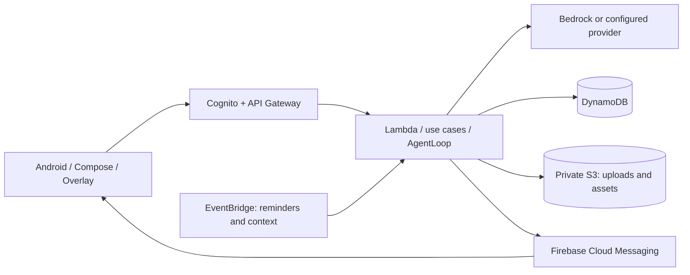

# RIN — public technical components

Reference implementation of an Android assistant with a serverless backend. This edition publishes code, contracts, tests and infrastructure. The personal installation, user data, operational settings, images and other assets remain private.

The main flow is **Android → API Gateway → Lambda → Amazon Bedrock**. This project has no MCP server. The backend also includes optional adapters for other model providers, selected through configuration.



| Directory | Public contents |
| --- | --- |
| `backend/src` | Domain, use cases, agent, tools, adapters and bootstrap |
| `backend/tests` | Tests with synthetic data |
| `backend/infra/terraform` | Parameterized AWS resources without state or credentials |
| `backend/seed` | Synthetic examples without personal profiles or relationships |
| `android` | Kotlin app, Compose, overlay, authentication and notifications |
| `scripts` | Publication checks and protection against including private data |

## Run the checks

Requirements: Node.js 22 or later, JDK 17, Gradle 9.7.1 and Android SDK 37. Project versions are pinned in build files and lockfiles.

```sh
npm run test:publication
npm run check:publication
cd backend
npm ci
npm test
npm run typecheck
npm run lint
npm run build
```

For Android, configure `ANDROID_HOME` and run with an installed Gradle distribution:

```sh
cd android
gradle --no-configuration-cache testDebugUnitTest assembleDebug lintDebug
```

The wrapper JAR is not distributed: this repository contains text only. Use an installed Gradle 9.7.1 distribution or generate the wrapper locally with `gradle wrapper`; the JAR remains ignored.

The build creates neutral geometric placeholders in `app/build/generated/publicResources`. It does not read, download or copy private RIN assets. Without Firebase configuration, the Google Services plugin is disabled; remote notifications require your own configuration. Authentication and APIs require your own environment, configured through `RIN_AGENT_BASE_URL`, `RIN_COGNITO_CLIENT_ID`, `RIN_COGNITO_USER_POOL_ID` and `RIN_COGNITO_REGION`.

Read the [architecture](docs/ARCHITECTURE.md), [development setup](docs/DEVELOPMENT.md) and [publication policy](docs/PUBLICATION.md). This repository is a technical sample without CI or automatic deployment. Checks can be run locally.

## Language and compatibility

Documentation, UI text, built-in responses and prompt guidance are in English. New sample profiles default to English; model replies can follow the user's language. Portuguese input patterns and regression fixtures remain to preserve support for existing commands and Brazilian bank statements. Stable identifiers such as `hipnose` and world-topic keys are retained for compatibility. Financial amounts still use BRL and Brazilian formatting; translating the sample does not change its financial rules or data sources.

Publishing the code does not grant rights to private characters or assets. This README grants no reuse license; choosing a license is separate from this technical separation.
